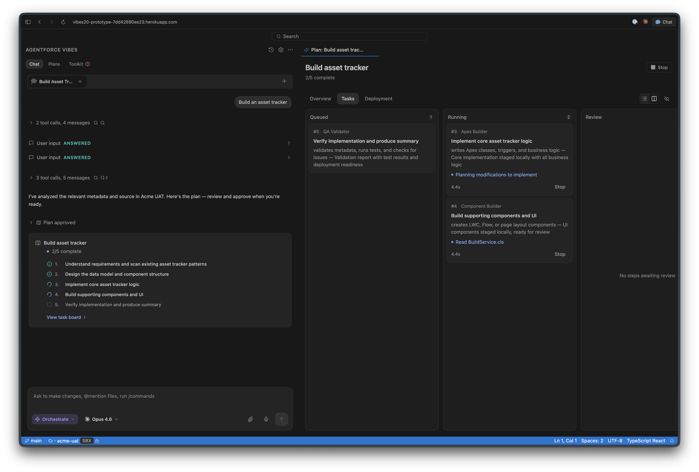

# Jennifer Mills

**Product Designer · Developer Platforms & AI** 
Vancouver, Canada

Turning complex workflows into tools people can understand, direct, and trust. Product direction, interaction design, and working software.

 

### What I'm working on

Lead designer at Salesforce, working on [Agentforce Vibes](https://developer.salesforce.com/docs/platform/agentforcevibes/guide/afv-overview.html).

Shipping the front end for agentic developer tools, designing interaction patterns directly in code. Connecting planning, agent coordination, reviewing changes, and deployment into a coherent developer experience.

 

### Selected work

**[Orchestrate](https://vibes20-prototype-7dd42890ee23.herokuapp.com/)** — From design exploration to product priority: a visual workflow connecting a Kanban task board with deployment, so developers can delegate complex work, follow agent progress, and step in when needed.

 

**[Vibes UI](https://vibes-ui-storybook-9e79be4ce5b9.herokuapp.com/)** — Shared React component library and Storybook for agentic developer tools. 60+ components, built with AI-assisted development.

 

### Connect

[X / @jlaurenmills](https://x.com/jlaurenmills)
